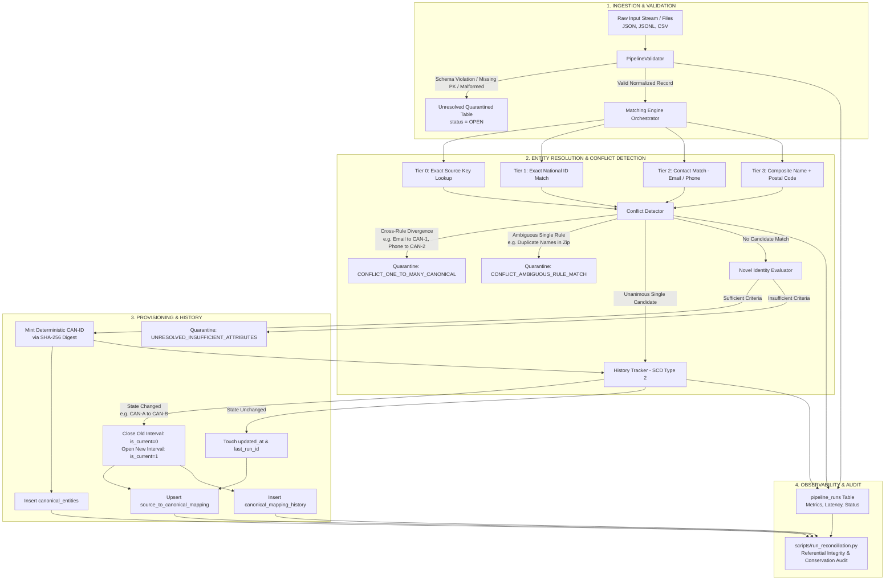
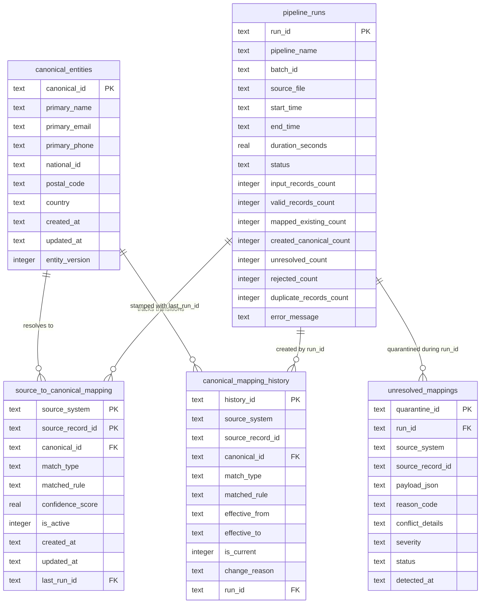

# Architectural Blueprint & System Design

## 1. Executive Summary
The Canonical ID Mapping system resolves source records originating from disparate systems into unified canonical master profiles. It handles identity fragmentation, prevents silent identity corruption from cross-attribute conflicts, maintains historical auditability, and guarantees idempotency.

---

## 2. End-to-End System Architecture

---

## 3. Data Processing Stages

### Stage 1: Validation & In-Batch De-duplication
- **Schema Validation**: Validates fields against `SourceRecordSchema` (Pydantic). Verifies required non-empty primary keys (`source_system`, `source_record_id`) and ISO-8601 formatting.
- **Normalizers**:
  - `email`: Trimmed, lowercased, validated against RFC regex.
  - `phone`: Non-digits stripped, leading country codes (`+1`) handled to yield standardized numeric representation.
  - `name`: Cleaned, lowercased, punctuation removed, business suffixes (`Inc`, `LLC`, `Corp`) stripped.
  - `national_id`: Uppercased, dashes/spaces stripped.
  - `postal_code`: Cleaned to standard 5-digit ZIP or alphanumeric postal code.
- **Intra-Batch Collision Check**:
  - If identical `(source_system, source_record_id)` with identical attributes appears in the same batch, it is deduplicated and counted in `duplicate_records_count`.
  - If identical source key appears with conflicting natural keys, it is quarantined immediately as `CONFLICT_SOURCE_KEY_COLLISION`.

### Stage 2: Matching Cascade & Precedence
1. **Tier 0: Exact Source Key Lookup** (`EXACT_SOURCE_ID`, Confidence 1.00):
   Checks if the source identifier is already mapped in `source_to_canonical_mapping`.
2. **Tier 1: Exact National ID** (`EXACT_NATIONAL_ID`, Confidence 1.00):
   Checks unique government / tax identifiers (`national_id`).
3. **Tier 2: Contact Identifier Rules**:
   - `RULE_EMAIL` (Confidence 0.95): Matches unique normalized contact email.
   - `RULE_PHONE` (Confidence 0.90): Matches unique normalized contact phone.
4. **Tier 3: Composite Deterministic Rule** (`RULE_COMPOSITE`, Confidence 0.85):
   Matches on combined `(normalized_name, postal_code)`.

### Stage 3: Conflict Detection & Ambiguity Quarantine
The system does not terminate greedily on the first rule. Instead, it evaluates across rules to detect multi-attribute divergence:
- **Cross-Rule Divergence (`CONFLICT_ONE_TO_MANY_CANONICAL`)**:
  Occurs when rule A (e.g. Email) resolves to `CAN-0001` while rule B (e.g. Phone) resolves to `CAN-0002`. Such records are quarantined in `unresolved_mappings` with complete diagnostic details.
- **Single-Rule Ambiguity (`CONFLICT_AMBIGUOUS_RULE_MATCH`)**:
  Occurs when a single composite query returns multiple candidate canonical records.

### Stage 4: SCD Type 2 History & Idempotency
- **Initial Mapping**: Creates an open-ended history record (`effective_from = now()`, `effective_to = NULL`, `is_current = 1`, `change_reason = 'INITIAL_MAPPING'`).
- **Reclassification**: Closes old interval (`effective_to = now()`, `is_current = 0`) and opens a new interval (`effective_from = now()`, `effective_to = NULL`, `is_current = 1`, `change_reason = 'CANONICAL_RECLASSIFICATION'`).
- **Idempotent Re-observation**: If the mapped `canonical_id` is identical, no new history rows are created. Only metadata timestamps are updated in the serving mapping table.

---

## 4. Analytical Views & Schema Relationships

